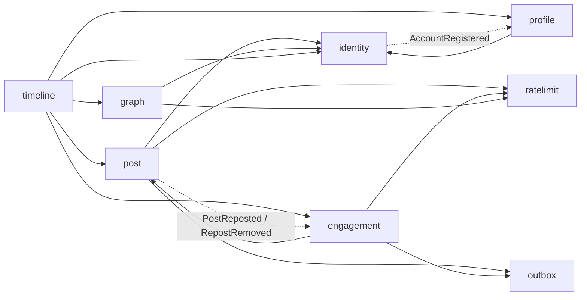

# Bafafá

Rede social brasileira no estilo microblog, construída como projeto de estudo e portfólio: um **monolito modular** em Java com Spring Boot, com fronteiras claras entre módulos desde o primeiro dia e decisões documentadas, para que cada parte possa evoluir (ou ser extraída para um serviço) com base em medição.

> **Status:** em desenvolvimento. O backend cobre autenticação, perfis, posts com respostas, curtidas, reposts, grafo de seguidores e feed (timeline), com rate limiting, cache e entrega confiável de eventos (outbox). O front-end está em [bafafa-web](https://github.com/leviberga/bafafa-web) e a busca está no [roadmap](#roadmap).
## Por que existe

Dois objetivos: aprender e exercitar arquitetura de backend num problema real e conhecido (feed, grafo social, cache, filas, consistência entre armazenamentos), e ter um bom projeto de portfólio. Há também uma motivação de fundo: com o tema de soberania digital em alta, vale ter alternativas nacionais de redes sociais, sujeitas à legislação brasileira.

## Stack

| Camada | Tecnologia |
|---|---|
| Linguagem | Java 21 |
| Framework | Spring Boot 4 (Web MVC, Security, Validation, Actuator, Scheduling) |
| Modularização | Spring Modulith |
| Dados relacionais | PostgreSQL 17, Spring Data JPA, Flyway |
| Documentos | MongoDB 8 (replica set de um nó, para transações), Spring Data MongoDB |
| Cache e rate limiting | Redis 7 (script Lua) |
| Autenticação | JWT (HS256, via OAuth2 Resource Server do Spring Security) + refresh token opaco |
| Testes | JUnit, MockMvc, Testcontainers, Awaitility |
| Ambiente local | Docker Compose |

## Arquitetura

Um único deployável, dividido em módulos que só conversam por APIs públicas e eventos. As fronteiras são **verificadas por teste** (`ModularityTests`), então uma dependência indevida quebra o build.



| Módulo | Responsabilidade | Armazenamento |
|---|---|---|
| `identity` | Contas, login, JWT, refresh tokens | PostgreSQL (schema `identity`) |
| `profile` | Perfil público (nome de exibição, bio), criado por evento | PostgreSQL (schema `profile`) |
| `post` | Posts, respostas e reposts; paginação por cursor; cache de leitura | MongoDB (`posts`) e Redis |
| `engagement` | Curtidas e contadores de curtidas e reposts | MongoDB (`likes`, `post_stats`, `processed_events`) |
| `graph` | Seguir e deixar de seguir | MongoDB (`follows`) |
| `timeline` | Feed hidratado (home e de perfil); compõe os demais módulos | não tem armazenamento próprio |
| `ratelimit` | Limitação de taxa por usuário, ação e IP | Redis |
| `outbox` | Outbox transacional e transações do MongoDB | MongoDB (`outbox_messages`) |

Regras de convivência:

- O pacote raiz de cada módulo é a sua **API pública**; qualquer subpacote (`domain`, `application`, `infra`, `web`) é interno.
- As dependências permitidas são declaradas em cada `package-info.java` (`allowedDependencies`).
- Efeitos colaterais entre módulos passam por **eventos de domínio**, nunca por chamadas diretas.
- Não há chaves estrangeiras nem joins entre módulos: cada um é dono do seu armazenamento e referencia os outros por ID.

Estrutura de cada módulo (versão leve de arquitetura hexagonal, com pureza só onde compensa):

```
<modulo>
├── package-info.java      // dependências permitidas
├── <API pública>          // interfaces, eventos e exceções expostas
├── domain                 // entidades e repositórios
├── application            // casos de uso
├── infra                  // segurança, JWT, Redis, configuração
└── web                    // controllers, DTOs, tratamento de erros
```

## Decisões de arquitetura

**Monolito modular em vez de microsserviços.** Microsserviços resolvem problemas de escala de times e custam caro em deploy, consistência distribuída e observabilidade. Com fronteiras verificadas e comunicação por eventos, extrair um módulo depois (provavelmente a timeline e as notificações) é uma decisão baseada em medição.

**Persistência poliglota.** Dados relacionais e transacionais (contas, tokens, perfis) ficam no PostgreSQL; posts, curtidas e o grafo social são documentos no MongoDB. Como não existe transação entre os dois bancos, a consistência entre módulos é feita por eventos, com o outbox abaixo.

**Autenticação.**
- *Access token*: JWT curto (15 min), com `sub` e expiração, sem dados sensíveis.
- *Refresh token*: valor aleatório opaco (não é JWT); no banco guardamos apenas o **hash SHA-256**. Chega ao cliente em cookie `HttpOnly`, `SameSite=Strict`, restrito ao caminho de autenticação.
- *Rotação*: cada uso do refresh o revoga e emite um novo. A revogação é um `UPDATE ... WHERE revoked_at IS NULL`, atômico no banco; se duas requisições disputarem o mesmo token, só uma vence.
- *Detecção de reuso*: apresentar um refresh já usado revoga a **família inteira** de tokens da sessão.
- *Login*: a resposta de erro é idêntica para conta inexistente e senha errada, e um hash falso é verificado quando a conta não existe, para não vazar a informação pelo tempo de resposta.
- Senhas com BCrypt.

**`@handle` no `identity`, perfil por evento.** O handle é único e identifica a conta, então vive em `identity`. Ao cadastrar, `identity` publica `AccountRegistered` e `profile` cria o perfil de forma assíncrona e idempotente (`@ApplicationModuleListener`, com o registro de publicação de eventos do Modulith no PostgreSQL). A dependência vai numa direção só (`profile → identity`).

**Posts.**
- Uma coleção só, com `type` (`POST`, `REPLY` ou `REPOST`), `parentId` e `rootId`. Reply de reply e busca de reply funcionam sem código duplicado.
- `_id` é um `ObjectId`, ordenável por tempo: a paginação é **por cursor** (`_id < cursor`), nunca por offset.
- Índices: `(authorId, _id desc)` para listar posts de um autor, `(parentId, _id)` para abrir as respostas de um post e um índice único parcial `(authorId, repostOfId)` para os reposts.
- Apagar é *soft delete* (`deletedAt`): a estrutura das conversas se mantém e as consultas ignoram o que foi apagado.
- Contadores ficam fora do documento, para não invalidar o cache a cada interação.

**Reposts.** Um repost é um documento `REPOST` na mesma coleção, apontando para o original (`repostOfId`); assim aparece no mesmo fluxo ordenado dos posts do autor. Há no máximo um repost por usuário por original (índice único parcial), as operações são idempotentes e desfazer apaga o ponteiro de fato. Reposts não recebem respostas, curtidas nem outros reposts: quem interage usa o original.

**Curtidas.** A relação (post, usuário) fica numa coleção própria com índice único, que é a fonte da verdade; as operações são idempotentes. A curtida e o evento correspondente são gravados na mesma transação (outbox, abaixo), e o contador é atualizado de forma assíncrona.

**Outbox transacional.** Curtidas e reposts gravam a mudança e o evento **na mesma transação do MongoDB** (replica set de um nó). Um relay agendado reserva cada mensagem de forma atômica e a entrega aos consumidores, com retentativa exponencial e *dead-letter* após 8 tentativas. A entrega é *at-least-once*, então os consumidores são idempotentes: o registro do evento processado e o ajuste do contador acontecem na mesma transação, e os incrementos comutam (+1 e -1 sem limite em zero), de modo que a ordem de entrega não importa. Consequência assumida: os contadores são **eventualmente consistentes**, com defasagem típica de cerca de meio segundo. Dois detalhes que valem registro: atualizar o contador dentro da transação do usuário criaria um ponto de contenção nos posts populares, e um erro dentro de uma transação do Mongo (inclusive chave duplicada) a aborta, então o tratamento de duplicidade fica fora dela, com retentativa para erros transitórios.

**Grafo social.** Seguir é uma aresta `(followerId, followeeId)` com índice único, no MongoDB, com as mesmas garantias de idempotência das curtidas e um limite de 2.000 contas seguidas por usuário (que também limita o custo do feed). Os totais de seguidores e seguindo são obtidos por contagem; quando isso pesar, podem virar contadores mantidos por eventos, como os de curtidas.

**Timeline (feed).** Estratégia de *fan-out on read*: ao abrir o feed, buscamos os posts e reposts de quem o usuário segue (mais os próprios), do mais novo ao mais antigo, com paginação por cursor, apoiados no índice `(authorId, _id)`. A resposta já vem **hidratada** (autor, contadores e estado do usuário) por consultas em lote, sem N+1, para que o front não precise de várias chamadas; reposts mostram o original e somem do feed se ele for apagado, e respostas ficam fora do feed. É deliberadamente simples e sempre consistente (apagar ou deixar de seguir vale na hora); o plano é medir com k6 e então evoluir para *fan-out on write*, ou um modelo híbrido, com números de antes e depois.

**Rate limiting.** Token bucket com recarga contínua, implementado em **script Lua no Redis**, o que o torna atômico e compartilhável entre várias instâncias da aplicação. A chave é por usuário e por ação, o relógio usado é o do próprio Redis (sem *clock skew*) e as chaves expiram sozinhas. Ao exceder o limite, a resposta é `429` com `Retry-After`. Limites por usuário: 10 posts, 30 respostas, 30 reposts, 60 curtidas e 60 ações de seguir, todos por minuto. Se o Redis estiver indisponível, o limiter deixa passar (*fail-open*) e registra um aviso: para ações do dia a dia, disponibilidade pesa mais que rigor.

**Limite por IP em login e cadastro.** Três baldes configuráveis (`bafafa.auth.rate-limit.*`): cadastro por IP, login por IP e login por conta. O de IP freia varredura de muitas contas; o de conta freia força bruta contra um alvo, mesmo vinda de vários IPs. Trade-offs assumidos: o limite por conta conta toda tentativa, então permite "trancar" o login de alguém por até um minuto, e IPs compartilhados dividem o balde de cadastro. Atrás de proxy, é preciso `server.forward-headers-strategy: native` para enxergar o IP real.

**Cache de leitura de posts.** Cache-aside no Redis (`post:v1:{id}`, TTL de 10 minutos com variação de ±10% contra avalanche de expiração). Só leituras populam o cache, então ficam quentes apenas os posts realmente lidos; apagar um post invalida a chave. Decisões de autorização leem sempre do banco, e falhas do Redis caem para o Mongo. O contador `bafafa.post.cache` (`hit`, `miss`, `error`) permite medir a taxa de acerto. Listagens não são cacheadas.

**CORS.** Configurável por `bafafa.cors.allowed-origins` (padrão `http://localhost:5173`, o Vite), com credenciais habilitadas para o cookie de refresh.

## API

Todas as rotas ficam sob `/api/v1`. Erros seguem o formato `ProblemDetail` (RFC 9457).

| Método | Rota | Acesso | Descrição |
|---|---|---|---|
| POST | `/auth/register` | público | Cria conta (e-mail, senha, handle, nome de exibição) |
| POST | `/auth/login` | público | Devolve o access token e define o cookie de refresh |
| POST | `/auth/refresh` | cookie | Troca o refresh por um novo par de tokens |
| POST | `/auth/logout` | cookie | Revoga a sessão e limpa o cookie |
| GET | `/auth/me` | autenticado | Conta autenticada |
| GET | `/profiles/{handle}` | público | Perfil público |
| GET | `/profiles/me` | autenticado | Meu perfil |
| PUT | `/profiles/me` | autenticado | Edita nome de exibição e bio |
| PUT | `/profiles/{handle}/follow` | autenticado | Segue um perfil (idempotente) |
| DELETE | `/profiles/{handle}/follow` | autenticado | Deixa de seguir (idempotente) |
| GET | `/profiles/{handle}/follow-stats` | público | Seguidores, seguindo e se o usuário já segue |
| POST | `/posts` | autenticado | Cria um post (até 280 caracteres) |
| GET | `/posts/{id}` | público | Lê um post |
| DELETE | `/posts/{id}` | autenticado (autor) | Apaga o próprio post |
| POST | `/posts/{id}/replies` | autenticado | Responde a um post |
| GET | `/posts/{id}/replies` | público | Respostas diretas, paginadas por `cursor` e `limit` |
| GET | `/posts?author={handle}` | público | Posts de um autor, do mais novo ao mais antigo, paginados |
| PUT | `/posts/{id}/like` | autenticado | Curte (idempotente) |
| DELETE | `/posts/{id}/like` | autenticado | Descurte (idempotente) |
| PUT | `/posts/{id}/repost` | autenticado | Reposta; devolve sempre o mesmo repost |
| DELETE | `/posts/{id}/repost` | autenticado | Desfaz o repost |
| GET | `/posts/{id}/engagement` | público | Curtidas, reposts e se o usuário curtiu ou repostou |
| GET | `/timeline/home` | autenticado | Feed de quem sigo e meus posts, hidratado e paginado |
| GET | `/timeline/users/{handle}` | público | Posts e reposts de um perfil, hidratados e paginados |

## Como rodar

Requisitos: JDK 21 ou superior e Docker (Docker Desktop no Windows) em execução.

```bash
./mvnw spring-boot:run        # no Windows: mvnw.cmd spring-boot:run
```

O `compose.yaml` sobe PostgreSQL, MongoDB (como replica set de um nó, requisito das transações) e Redis automaticamente (Spring Boot Docker Compose) e configura as conexões. A API fica em `http://localhost:8080`.

Configuração relevante:

| Propriedade / variável | Descrição |
|---|---|
| `JWT_SECRET` | Segredo de assinatura do JWT, com no mínimo 32 bytes. O valor padrão serve **apenas para desenvolvimento**; em produção, defina a variável de ambiente. |
| `bafafa.auth.access-token-ttl` | Validade do access token (padrão `15m`) |
| `bafafa.auth.refresh-token-ttl` | Validade do refresh token (padrão `30d`) |
| `bafafa.auth.refresh-cookie-secure` | `false` em desenvolvimento local (http); deve ser `true` em produção (https) |
| `bafafa.auth.rate-limit.*` | Limites de cadastro por IP, login por IP e login por conta (`capacity` e `period`) |
| `bafafa.post.cache.ttl` | Validade do cache de posts (padrão `10m`) |
| `bafafa.outbox.*` | Tentativas máximas, atraso base de retentativa, reserva e tamanho do lote do relay |
| `bafafa.cors.allowed-origins` | Origens permitidas pelo CORS (padrão `http://localhost:5173`) |

Problemas comuns no ambiente local:

- **Porta 27017 ocupada**: se houver um MongoDB instalado no Windows como serviço, ele atende antes do container e, por não ser um replica set, as transações falham (`Transaction numbers are only allowed on a replica set member`). Pare o serviço.
- **`There are already Docker Compose services running, skipping startup`**: o Spring Boot só sobe os containers quando nenhum serviço do compose está rodando. Se só parte deles estiver de pé, rode `docker compose down` (sem `-v`, que apagaria os dados) e deixe a aplicação subir o conjunto.

## Testes

```bash
./mvnw test
```

Os testes de integração usam **Testcontainers** com PostgreSQL, MongoDB (como replica set) e Redis reais (nada de bancos em memória), então o Docker precisa estar rodando. Eles sobem o Flyway do zero e deixam o Hibernate validar o schema, o que também garante que as migrações funcionam. A estratégia:

- `ModularityTests`: valida as fronteiras entre módulos.
- Autenticação: cadastro, login, `/me`, senha errada, e-mail duplicado, rotação e **reuso do refresh token revogando a sessão**, logout, e os limites por IP e por conta.
- Perfil: o perfil nasce do evento de cadastro e pode ser editado.
- Posts: criação, respostas em thread com a mesma raiz, paginação por cursor, exclusão apenas pelo autor, ids e cursores inválidos, cache de leitura (o dado some do banco e a API continua respondendo) e rate limit por usuário e por ação.
- Curtidas e reposts: idempotência, contadores corretos (eventualmente consistentes, verificados com Awaitility), regras de elegibilidade e **testes de concorrência** (várias requisições simultâneas contam uma vez por usuário).
- Outbox: entrega, rollback sem rastro, retentativa e dead-letter.
- Grafo e timeline: seguir e deixar de seguir, ordenação e paginação do feed, exclusão de respostas e de desconhecidos, hidratação dos contadores, reposts que mostram o original e somem se ele for apagado.
- Rate limiter: capacidade, rejeição com `Retry-After`, chaves independentes e recarga de tokens ao longo do tempo.

Uma configuração compartilhada de containers (`TestcontainersConfiguration`) permite reaproveitar os mesmos containers e o mesmo contexto Spring entre as classes de teste.

## Roadmap

- [x] `identity`: cadastro, login, refresh com rotação e detecção de reuso, logout
- [x] `profile`: perfil criado por evento, leitura pública e edição
- [x] `post`: posts, respostas, paginação por cursor, exclusão lógica
- [x] `ratelimit`: token bucket em Lua no Redis, aplicado a posts e respostas
- [x] Limite por IP em login e cadastro (configurável)
- [x] Cache de leitura de posts mais lidos no Redis
- [x] Curtidas e reposts, com contadores fora do documento do post
- [x] *Outbox* transacional no MongoDB, com consumidores idempotentes
- [x] Grafo de seguidores
- [x] Timeline por leitura (*fan-out on read*), hidratada e paginada por cursor
- [ ] Front-end em React (Vite + TypeScript)
- [ ] Reconciliação dos contadores (rede de segurança para mensagens em dead-letter)
- [ ] Observabilidade e testes de carga (k6), com números de antes e depois de cada otimização
- [ ] Timeline por escrita (*fan-out on write*) ou híbrida, comparada com a atual
- [ ] Busca com Elasticsearch, alimentada por eventos
- [ ] Notificações, como novos consumidores do outbox
- [ ] Mídia: armazenamento compatível com S3 (MinIO em desenvolvimento)
- [ ] Moderação básica (denúncias e remoção)
- [ ] Deploy

## Limitações conhecidas

- Os contadores de curtidas e reposts são eventualmente consistentes (cerca de meio segundo). Mensagens que esgotam as tentativas ficam em *dead-letter* até alguém tratá-las, e ainda não há job de reconciliação.
- O relay do outbox funciona melhor com uma instância ativa: com várias, a reserva atômica evita entregas duplicadas na maioria dos casos, mas a ordem entre mensagens não é garantida (os contadores toleram isso; consumidores sensíveis à ordem vão exigir ordenação por agregado).
- Os endpoints de `/posts` ainda devolvem apenas o `authorId`; a versão hidratada (com autor e contadores) está nos endpoints de `/timeline`.
- No feed, um mesmo post pode aparecer duas vezes (o original e o repost de alguém que você segue), e uma página pode vir com menos itens que o `limit` quando reposts de posts apagados são descartados; o `nextCursor` indica se há mais.
- O feed por leitura tem custo proporcional a quanto o usuário segue (limitado a 2.000 contas); é a primeira candidata a medição e otimização.
- Os totais de seguidores e seguindo usam contagem direta, simples e exata, mas pesada para contas muito grandes.
- A configuração de segurança está centralizada no módulo `identity` e já conhece caminhos de outros módulos. Quando houver mais módulos, o ideal é movê-la para um módulo compartilhado.
- Após o logout, o access token continua válido até expirar (no máximo 15 minutos), uma característica de JWT sem estado e o motivo de ele ser curto.
- Entre apagar no Mongo e invalidar o Redis existe uma janela de milissegundos em que uma leitura pode ver a cópia antiga.

## Licença

A definir.