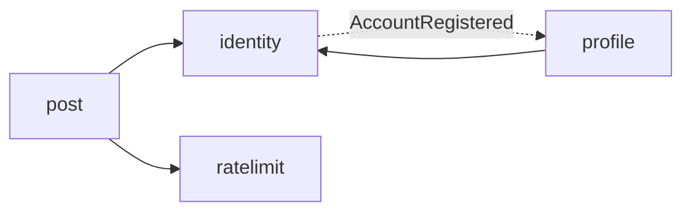

# Bafafá

Rede social brasileira no estilo microblog, construída como projeto de estudo e portfólio: um **monolito modular** em Java com Spring Boot, com fronteiras claras entre módulos desde o primeiro dia e decisões documentadas, para que cada parte possa evoluir (ou ser extraída para um serviço) com base em medição.
> **Status:** em desenvolvimento. O backend já cobre autenticação, perfis, posts com respostas e rate limiting. Timeline, busca e front-end estão no [roadmap](#roadmap).

## Por que existe

Dois objetivos: aprender e exercitar arquitetura de backend num problema real e conhecido (feed, grafo social, cache, filas, busca), e ter um bom projeto de portfólio. Há também uma motivação de fundo: com o tema de soberania digital em alta, vale ter alternativas nacionais de redes sociais, sujeitas à legislação brasileira.

## Stack

| Camada | Tecnologia |
|---|---|
| Linguagem | Java 21 |
| Framework | Spring Boot 4 (Web MVC, Security, Validation, Actuator) |
| Modularização | Spring Modulith |
| Dados relacionais | PostgreSQL 17, Spring Data JPA, Flyway |
| Documentos | MongoDB 8, Spring Data MongoDB |
| Cache e rate limiting | Redis 7 (script Lua) |
| Autenticação | JWT (HS256, via OAuth2 Resource Server do Spring Security) + refresh token opaco |
| Testes | JUnit, MockMvc, Testcontainers, Awaitility |
| Ambiente local | Docker Compose |

## Arquitetura

Um único deployável, dividido em módulos que só conversam por APIs públicas e eventos. As fronteiras são **verificadas por teste** (`ModularityTests`), então uma dependência indevida quebra o build.



| Módulo | Responsabilidade | Armazenamento |
|---|---|---|
| `identity` | Contas, login, JWT, refresh tokens | PostgreSQL (schema `identity`) |
| `profile` | Perfil público (nome de exibição, bio), criado por evento | PostgreSQL (schema `profile`) |
| `post` | Posts e respostas, paginação por cursor | MongoDB (coleção `posts`) |
| `ratelimit` | Limitação de taxa por usuário e ação | Redis |

Regras de convivência:

- O pacote raiz de cada módulo é a sua **API pública**; qualquer subpacote (`domain`, `application`, `infra`, `web`) é interno.
- As dependências permitidas são declaradas em cada `package-info.java` (`allowedDependencies`).
- Efeitos colaterais entre módulos passam por **eventos de domínio**, nunca por chamadas diretas.
- Não há chaves estrangeiras nem joins entre módulos: cada um é dono do seu schema e referencia os outros por ID.

Estrutura de cada módulo (versão leve de arquitetura hexagonal, com pureza só onde compensa):

```
<modulo>
├── package-info.java      // dependências permitidas
├── <API pública>          // interfaces, eventos e exceções expostas
├── domain                 // entidades e repositórios
├── application            // casos de uso
├── infra                  // segurança, JWT, Redis, configuração
└── web                    // controllers, DTOs, tratamento de erros
```

## Decisões de arquitetura

**Monolito modular em vez de microsserviços.** Microsserviços resolvem problemas de escala de times e custam caro em deploy, consistência distribuída e observabilidade. Com fronteiras verificadas e comunicação por eventos, extrair um módulo depois (provavelmente timeline e notificações) é uma decisão baseada em medição.

**Persistência poliglota.** Dados relacionais e transacionais (contas, tokens, perfis) ficam no PostgreSQL; posts são documentos no MongoDB. A consequência assumida: não existe transação entre os dois bancos, então a consistência entre módulos é feita por eventos. Publicar eventos de posts com garantia exigirá o padrão *outbox* (veja o roadmap).

**Autenticação.**
- *Access token*: JWT curto (15 min), com `sub` e expiração, sem dados sensíveis.
- *Refresh token*: valor aleatório opaco (não é JWT); no banco guardamos apenas o **hash SHA-256**. Chega ao cliente em cookie `HttpOnly`, `SameSite=Strict`, restrito ao caminho de autenticação.
- *Rotação*: cada uso do refresh o revoga e emite um novo. A revogação é um `UPDATE ... WHERE revoked_at IS NULL`, atômico no banco; se duas requisições disputarem o mesmo token, só uma vence.
- *Detecção de reuso*: apresentar um refresh já usado revoga a **família inteira** de tokens da sessão.
- *Login*: a resposta de erro é idêntica para conta inexistente e senha errada, e um hash falso é verificado quando a conta não existe, para não vazar a informação pelo tempo de resposta.
- Senhas com BCrypt.

**`@handle` no `identity`, perfil por evento.** O handle é único e identifica a conta, então vive em `identity`. Ao cadastrar, `identity` publica `AccountRegistered` e `profile` cria o perfil de forma assíncrona e idempotente (`@ApplicationModuleListener`, com o registro de publicação de eventos do Modulith no PostgreSQL). A dependência vai numa direção só (`profile → identity`).

**Posts.**
- Uma coleção só, com `type` (`POST` ou `REPLY`), `parentId` e `rootId`. Reply de reply, curtir reply e buscar reply funcionam sem código duplicado.
- `_id` é um `ObjectId`, ordenável por tempo: a paginação é **por cursor** (`_id < cursor`), nunca por offset.
- Índices: `(authorId, _id desc)` para listar posts de um autor e `(parentId, _id)` para abrir as respostas de um post.
- Apagar é *soft delete* (`deletedAt`): a estrutura das conversas se mantém e as consultas ignoram o que foi apagado.
- Contadores (curtidas, reposts) ficarão fora do documento, para não invalidar o cache a cada interação.

**Rate limiting.** Token bucket com recarga contínua, implementado em **script Lua no Redis**, o que o torna atômico e compartilhável entre várias instâncias da aplicação. A chave é por usuário e por ação (postar não consome o limite de responder), o relógio usado é o do próprio Redis (sem *clock skew* entre instâncias) e as chaves expiram sozinhas. Ao exceder o limite, a resposta é `429` com `Retry-After`. Limites atuais: 10 posts por minuto e 30 respostas por minuto, por usuário. Se o Redis estiver indisponível, o limiter deixa passar (*fail-open*) e registra um aviso: para posts, disponibilidade pesa mais que rigor.

## API

Todas as rotas ficam sob `/api/v1`. Erros seguem o formato `ProblemDetail` (RFC 9457).

| Método | Rota | Acesso | Descrição |
|---|---|---|---|
| POST | `/auth/register` | público | Cria conta (e-mail, senha, handle, nome de exibição) |
| POST | `/auth/login` | público | Devolve o access token e define o cookie de refresh |
| POST | `/auth/refresh` | cookie | Troca o refresh por um novo par de tokens |
| POST | `/auth/logout` | cookie | Revoga a sessão e limpa o cookie |
| GET | `/auth/me` | autenticado | Conta autenticada |
| GET | `/profiles/{handle}` | público | Perfil público |
| GET | `/profiles/me` | autenticado | Meu perfil |
| PUT | `/profiles/me` | autenticado | Edita nome de exibição e bio |
| POST | `/posts` | autenticado | Cria um post (até 280 caracteres) |
| GET | `/posts/{id}` | público | Lê um post |
| DELETE | `/posts/{id}` | autenticado (autor) | Apaga o próprio post |
| POST | `/posts/{id}/replies` | autenticado | Responde a um post |
| GET | `/posts/{id}/replies` | público | Respostas diretas, paginadas por `cursor` e `limit` |
| GET | `/posts?author={handle}` | público | Posts de um autor, do mais novo ao mais antigo, paginados |

## Como rodar

Requisitos: JDK 21 ou superior e Docker (Docker Desktop no Windows) em execução.

```bash
./mvnw spring-boot:run        # no Windows: mvnw.cmd spring-boot:run
```

O `compose.yaml` sobe PostgreSQL, MongoDB e Redis automaticamente (Spring Boot Docker Compose) e configura as conexões. A API fica em `http://localhost:8080`.

Configuração relevante:

| Propriedade / variável | Descrição |
|---|---|
| `JWT_SECRET` | Segredo de assinatura do JWT, com no mínimo 32 bytes. O valor padrão serve **apenas para desenvolvimento**; em produção, defina a variável de ambiente. |
| `bafafa.auth.access-token-ttl` | Validade do access token (padrão `15m`) |
| `bafafa.auth.refresh-token-ttl` | Validade do refresh token (padrão `30d`) |
| `bafafa.auth.refresh-cookie-secure` | `false` em desenvolvimento local (http); deve ser `true` em produção (https) |

## Testes

```bash
./mvnw test
```

Os testes de integração usam **Testcontainers** com PostgreSQL, MongoDB e Redis reais (nada de bancos em memória), então o Docker precisa estar rodando. Eles sobem o Flyway do zero e deixam o Hibernate validar o schema, o que também garante que as migrações funcionam. A estratégia:

- `ModularityTests`: valida as fronteiras entre módulos.
- Fluxo de autenticação: cadastro, login, `/me`, senha errada, e-mail duplicado, rotação e **reuso do refresh token revogando a sessão**, logout.
- Fluxo de perfil: o perfil nasce do evento de cadastro (verificado com Awaitility, por ser assíncrono) e pode ser editado.
- Fluxo de posts: criação, respostas em thread com a mesma raiz, paginação por cursor, exclusão apenas pelo autor, ids e cursores inválidos.
- Rate limiter: capacidade, rejeição com `Retry-After`, chaves independentes e recarga de tokens ao longo do tempo.

Uma configuração compartilhada de containers (`TestcontainersConfiguration`) permite reaproveitar os mesmos containers e o mesmo contexto Spring entre as classes de teste.

## Roadmap

- [x] `identity`: cadastro, login, refresh com rotação e detecção de reuso, logout
- [x] `profile`: perfil criado por evento, leitura pública e edição
- [x] `post`: posts, respostas, paginação por cursor, exclusão lógica
- [x] `ratelimit`: token bucket em Lua no Redis, aplicado a posts e respostas
- [ ] Limite por IP em login e cadastro (configurável)
- [ ] Cache de leitura de posts populares no Redis
- [ ] *Outbox* para publicar eventos de posts com garantia (Mongo → eventos confiáveis)
- [ ] Timeline: estudo de *fan-out on write* x *fan-out on read* e hidratação dos posts com dados do autor
- [ ] Curtidas e reposts, com contadores fora do documento do post
- [ ] Busca com Elasticsearch, alimentada por eventos
- [ ] Mídia: armazenamento compatível com S3 (MinIO em desenvolvimento)
- [ ] Front-end em React (Vite + TypeScript)
- [ ] Moderação básica (denúncias e remoção)
- [ ] Observabilidade e testes de carga (k6), com números de antes e depois de cada otimização
- [ ] Deploy

## Limitações conhecidas

- As respostas de posts trazem apenas o `authorId`; compor o post com os dados do autor é o problema de hidratação da timeline.
- A configuração de segurança está centralizada no módulo `identity` e já conhece caminhos de outros módulos. Quando houver mais módulos, o ideal é movê-la para um módulo compartilhado.
- Após o logout, o access token continua válido até expirar (no máximo 15 minutos), uma característica de JWT sem estado e o motivo de ele ser curto.

## Licença

A definir.